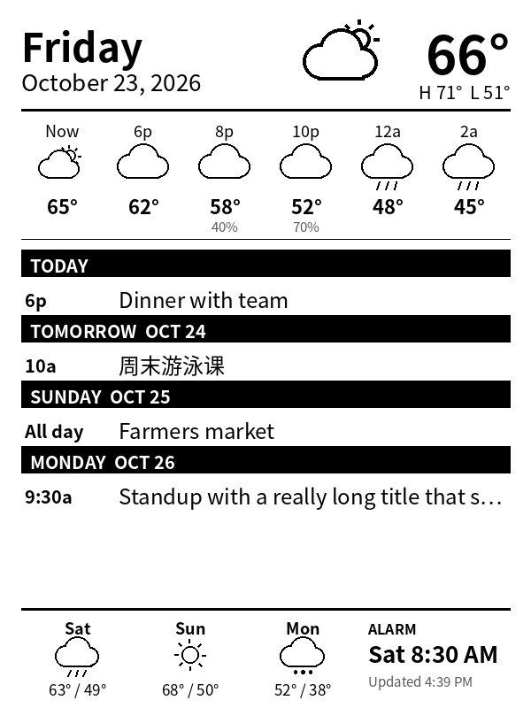

# kindle-dash

Turn an old **Kindle 4** (model D01100, the 2011 non-touch Kindle) into an always-on **calendar, weather and alarm dashboard**, using only free cloud services.

<p align="center">
  
  &nbsp;&nbsp;
  
</p>

**What the screen shows:**
- the date, current weather and today's high and low
- a 12-hour forecast strip and a 3-day outlook
- the next few days of your **Apple iCloud** calendar. Chinese and other CJK titles work, and any standard `.ics` feed works too.
- your next alarm. At alarm time the screen flashes a full-screen **WAKE UP** card.

**Switching modes needs no computer:**
- **Dashboard → reader:** press any button.
- **Reader → dashboard:** restart the Kindle.

> ⚠️ **The alarm is visual only.** The Kindle 4 has no speaker, so keep a phone alarm if you need sound.

Tested on a Kindle 4 (D01100) running firmware **4.1.2**.

---

## How it works

```
Cloudflare Worker  ── Cron Trigger, every 15 min ──▶  GitHub Actions (render.yml)
   ▲   │                                                 │ fetch iCloud .ics + Open-Meteo
   │   │                                                 │ draw 600×800 grayscale PNG (Pillow)
   │   └──────────── KV storage ◀──── upload ────────────┘
   │
   └── plain HTTP ── Kindle 4 (jailbroken): wget the image every 15 min, ask /status every minute
```

| Piece | Why it's there |
|---|---|
| **GitHub Actions** | Runs the Python renderer for free on public repos. Python and Pillow make the layout easy to change. |
| **Cloudflare Worker + KV** | The Kindle's BusyBox `wget` (2013) only speaks **plain HTTP**. GitHub, Apple and most hosts require modern HTTPS, so the Worker serves the finished image over `http://` from KV storage. It also answers `/status` with `OK` or `ALARM`, so the Kindle never needs an accurate clock. |
| **Worker Cron Trigger** | GitHub's own `schedule:` is best-effort and in practice skipped runs for hours at a time. The Worker starts the workflow through GitHub's API every 15 minutes instead. GitHub's schedule remains as an hourly backup. |
| **Kindle scripts** | A small BusyBox shell loop draws the PNG with `eips`, flashes on alarm, and watches the buttons. |

Repository layout:

```
render/      render.py: calendar + weather → dash.png / alarm.png
.github/     render.yml: renders and uploads to Cloudflare KV
worker/      worker.js: serves images and /status, triggers renders
kindle/      scripts copied to the Kindle (/mnt/us/dashboard)
docs/        preview images (sample data)
```

---

## What you need

- A Kindle 4 (D01100) on firmware 4.1.x, plus a **data-capable** micro-USB cable. Many cables are charge-only.
- A Mac or Linux computer with `ssh` and `scp`. Windows works with WSL or OpenSSH.
- Free accounts on **GitHub** and **Cloudflare**.
- An **iCloud calendar** you can share, or any public `.ics` link.

Allow about 20 minutes for the cloud side and 45 minutes for the Kindle.

---

## Part A: cloud setup

### A1. Get your iCloud calendar's share link
Do this for each calendar you want on the dashboard.

- **On iPhone or iPad:** open **Calendar**, then tap **Calendars**. Tap **ⓘ** next to the calendar, turn on **Public Calendar**, then tap **Share Link…** and copy it.
- **On a Mac:** open **Calendar** and right-click the calendar (under *iCloud*). Choose **Share Calendar…**, tick **Public Calendar**, and copy the URL.
- **On the web:** at icloud.com/calendar, click the share icon next to the calendar, tick **Public Calendar**, and copy the link.

The link looks like `webcal://p123-caldav.icloud.com/published/2/…`. Paste it exactly as given; the renderer converts `webcal://` to `https://`. For several calendars, join the links with commas.

> **Privacy:** anyone with this long random link can read the calendar. It isn't searchable, and you only ever store it as a GitHub **Secret**. To revoke it, turn **Public Calendar** off and on again to get a new link.

### A2. Create the Cloudflare Worker
1. **Create the storage.** At dash.cloudflare.com, go to **Storage & Databases → Workers KV → Create**. Name it `kindle-dash` and note its **ID**.
2. **Create the Worker.** Go to **Build → Compute → Workers & Pages → Create application → Start with Hello World!**, name it `kindle-dash`, and click **Deploy**. Don't choose "Upload static files"; that option is for websites, not code.
3. **Add the code.** On the Worker's page, click **Edit code** at the top right. Replace everything with the contents of [`worker/worker.js`](worker/worker.js) and click **Deploy**.
   *Tip:* `pbcopy < worker/worker.js` copies the file on a Mac. If the editor looks read-only, you're probably viewing an old version under **Deployments**; go back to the Worker's main page.
4. **Connect the storage.** Go to **Settings → Bindings → Add → KV namespace**. Set the variable name to **`DASH`** (uppercase) and choose the namespace `kindle-dash`.
5. **Add settings** under **Settings → Variables and Secrets**:

   | Name | Type | Value |
   |---|---|---|
   | `KEY` | Secret | a random string you invent, e.g. `k7Qp2xR9mZ`. It acts as the URL's password. |
   | `TZ_NAME` | Text | e.g. `America/Los_Angeles` |
   | `ALARM_MINUTES` | Text | `5` (how long the alarm flashes) |

6. **Test it:** open `http://kindle-dash.<your-subdomain>.workers.dev/<KEY>/status`. It should say `OK 17:42`.
   - `not found` means the KEY in the address is wrong or not set yet.
   - `Setup error: KV binding missing` means step 4 isn't done.

7. **Create a Cloudflare API token** for GitHub to upload with. Go to **My Profile → API Tokens → Create Token → Custom token** and give it **Account → Workers KV Storage → Edit**. Also note your **Account ID**, shown on the Workers & Pages overview.
   To verify the token, run this on **one line**, with no trailing `\`:
   `curl "https://api.cloudflare.com/client/v4/user/tokens/verify" -H "Authorization: Bearer YOUR_TOKEN"`

*Prefer the command line?* Fill the KV ID into [`worker/wrangler.toml`](worker/wrangler.toml), then run `npx wrangler deploy` and `npx wrangler secret put KEY`. That also creates the binding and the Cron Trigger from A4.

### A3. Put the code on GitHub
1. Fork this repo, or push your own copy as a **public** repo. Public repos get unlimited free Actions minutes.
2. In the repo, go to **Settings → Secrets and variables → Actions**.

   **Secrets:**

   | Name | Value |
   |---|---|
   | `ICAL_URL` | iCloud link(s) from A1 |
   | `CF_API_TOKEN` | token from A2.7 |
   | `CF_ACCOUNT_ID` | account ID from A2.7 |
   | `CF_KV_NAMESPACE_ID` | KV namespace ID from A2.1 |

   **Variables:**

   | Name | Example | Meaning |
   |---|---|---|
   | `ALARMS` | `06:45@1-5,08:30@6-7` | see [Alarm format](#alarm-format) |
   | `LAT`, `LON` | `40.7128`, `-74.0060` | weather location; the default is Sunnyvale, CA |
   | `UNITS` | `imperial` | or `metric` |
   | `TZ_NAME` | `America/Los_Angeles` | time zone for dates and times |

### A4. Make the Worker the 15-minute timer
1. **Create a GitHub fine-grained token.** On GitHub, go to **Settings → Developer settings → Fine-grained tokens → Generate**. Under **Repository access**, choose *Only select repositories* and pick your copy. Under **Permissions**, set **Actions** to *Read and write*. Set an expiry and **put a reminder in your calendar to renew it**.
2. In the Worker's **Settings → Variables and Secrets**, add:
   - `GH_TOKEN` (type *Secret*): the token from step 1
   - `GH_REPO` (type *Text*): `your-username/kindle-dash`
3. Under **Settings → Trigger Events → Add → Cron Triggers**, add `*/15 * * * *`.

### A5. First run
1. Go to **Actions → Render Kindle dashboard** and click **Run workflow**.
   ⚠️ Use the **Run workflow** button, not **Re-run jobs** on an old run. A re-run replays the *old* commit's code.
2. When the run turns green, open `http://kindle-dash.<subdomain>.workers.dev/<KEY>/dash.png`. You should see your dashboard, with *Updated …* in the footer.
3. Within 15 minutes, a run with the event **workflow_dispatch** should appear by itself. That's the Worker's timer working.

---

## Part B: Kindle setup

> Charge the Kindle above 50% and connect it to Wi-Fi first. Copy off any personal documents to be safe.

### B1. Jailbreak
1. Download the **Kindle 4 NT jailbreak** (`kindle-jailbreak-k4-*.zip`). It's linked from the MobileRead wiki page [Kindle4NTHacking](https://wiki.mobileread.com/wiki/Kindle4NTHacking).
2. Plug in the Kindle. It appears as a USB drive named **Kindle**; if it doesn't, try another cable. Copy these to the **top level** of the drive:
   - `data.tar.gz` (check the full name with ⌘I, since Finder may hide `.gz`)
   - `ENABLE_DIAGS`
   - the whole `diagnostic_logs` folder
3. Eject, then go to **Menu → Settings → Menu → Restart**. The Kindle boots into **TEQUILA – System Diags**.
4. Choose **D) Exit, Reboot or Disable Diags → R) Reboot System → Q) To continue**, then wait.
5. After a reboot, the book **"You are Jailbroken"** appears in your library. ✅ You can delete the three jailbreak files now.
   - *Stuck in diags?* Choose **D → D) Disable Diagnostics → Q**.

### B2. SSH over Wi-Fi (USBNetwork)
1. From NiLuJe's *Kindle Hacks* thread on MobileRead, linked from the wiki page above, download **`kindle-usbnetwork-0.xx.N-k4.zip`** and read its `README_FIRST.txt`.
2. Copy the `Update_usbnetwork_…_k4_install.bin` file to the drive, then go to **Menu → Settings → Menu → Update Your Kindle**.
3. On the drive, edit `usbnet/etc/config` and set:
   ```
   K3_WIFI="true"
   K3_WIFI_SSHD_ONLY="true"
   ```
   They're named after the Kindle 3, but they control Wi-Fi SSH on the Kindle 4 too.
4. **Add an SSH key.** The SSH server is from about 2013, so use **RSA**; it won't accept newer key types:
   ```sh
   ssh-keygen -t rsa -b 2048 -f ~/.ssh/kindle_rsa -N ""
   cp ~/.ssh/kindle_rsa.pub /Volumes/Kindle/usbnet/etc/authorized_keys
   ```
5. **Make it start at every boot:** `touch /Volumes/Kindle/usbnet/auto`. You can delete `DISABLED_auto`.
   This is more reliable than typing `;debugOn` / `~usbNetwork` in the search box.
   ⚠️ While USBNetwork is enabled, the USB cable becomes a network link instead of a drive, so copy files with `scp` from now on.
6. Eject the Kindle and restart it.
7. **Find its IP address.** The Kindle 4 doesn't show it, so look in your router's device list. Or match the Kindle's **Wi-Fi MAC**, shown under **Menu → Settings → Device Info**:
   ```sh
   ipconfig getifaddr en0                       # your Mac, e.g. 192.168.1.72
   for i in $(seq 1 254); do ping -c1 -W 300 192.168.1.$i >/dev/null 2>&1 & done; wait
   arp -a | grep -i f0:a2:25                    # start of the Kindle's MAC (Amazon prefix)
   ```
8. Add this to `~/.ssh/config`. Modern macOS refuses the old algorithms unless you allow them:
   ```
   Host kindle
       HostName 192.168.1.108
       User root
       IdentityFile ~/.ssh/kindle_rsa
       HostKeyAlgorithms +ssh-rsa
       PubkeyAcceptedAlgorithms +ssh-rsa
       KexAlgorithms +diffie-hellman-group14-sha1,diffie-hellman-group1-sha1
   ```
   Then run `ssh kindle`. You should get a `[root@kindle root]#` prompt. Make sure the Kindle is awake, because it turns Wi-Fi off when the screensaver comes on.

### B3. Install the dashboard
On your computer:
```sh
cp kindle/dashboard/config.example.sh kindle/dashboard/config.sh
# edit config.sh: BASE="http://kindle-dash.<subdomain>.workers.dev/<KEY>"   (http, not https)
scp -O -r kindle/dashboard kindle:/mnt/us/
```
`-O` makes macOS use the legacy scp protocol that the Kindle understands. `config.sh` is git-ignored because it contains your KEY.

### B4. Start it
```sh
ssh kindle
wget -q -O - http://kindle-dash.<subdomain>.workers.dev/<KEY>/status   # should print: OK hh:mm
sh /mnt/us/dashboard/start.sh                                          # prints: dashboard started (pid …)
```
Plug the Kindle into a USB charger. In dashboard mode, Wi-Fi stays on and sleep is disabled, so on battery alone it lasts only about a day.

### B5. Switching without a computer
Run this once:
```sh
sh /mnt/us/dashboard/install-autostart.sh
```

| From → to | How |
|---|---|
| Dashboard → reader | press **any button** |
| Reader → dashboard | **Menu → Settings → Menu → Restart**; the dashboard appears about a minute after boot |

- **Turn it off:** `rm /mnt/us/dashboard/AUTOSTART`. The Kindle then boots normally.
- **Remove it completely:** `sh /mnt/us/dashboard/install-autostart.sh uninstall`.
- **Without autostart,** start it with `ssh kindle 'sh /mnt/us/dashboard/start.sh'`. To get back to reader mode, press a button, run `stop.sh`, or hold power for 20 seconds.

The install adds `/etc/init.d/dashboard` and `/etc/rc5.d/S99dashboard`, using `mntroot rw` and then `mntroot ro`. A firmware update may remove them, in which case you simply reinstall.

---

## Everyday use

### Alarm format
The `ALARMS` GitHub variable holds `HH:MM@days` entries, comma-separated, in 24-hour time. Days are numbered 1 = Monday through 7 = Sunday. Use ranges with `-` and separate pieces with `;`.

| Value | Meaning |
|---|---|
| `06:45@1-5` | weekdays at 6:45 |
| `08:30@6-7` | weekends at 8:30 |
| `07:00` | every day |
| `06:00@1;3;5` | Mon, Wed and Fri |

Changes take effect at the next render, within about 15 minutes. The screen flashes for `ALARM_MINUTES`, which is set on the Worker.

### Customizing the layout
Everything is drawn in [`render/render.py`](render/render.py) with Pillow. To preview offline:
```sh
pip install -r render/requirements.txt
SAMPLE_ICS=my.ics WX_FIXTURE=wx.json OUT=out/dash.png python render/render.py
```
Leave out `WX_FIXTURE` to call Open-Meteo live. It's free and needs no key. The output must stay **600×800, 8-bit grayscale PNG** for `eips`.

---

## Kindle 4 firmware quirks (BusyBox 1.7.2)
These are worth knowing if you change the shell scripts:
- There's no `nohup` and no `setsid`. `loop.sh` ignores `SIGHUP` itself, so it survives SSH logout.
- `wget` has **no `-T` timeout**. `loop.sh` uses a watchdog subshell instead.
- `grep` has no `-E`. Use repeated `-e` patterns.
- Buttons are `/dev/input/event0` (keypad), `event1` (5-way) and `event2`. A blocking `dd … bs=16 count=1` detects a press.
- `/etc/init.d/framework stop` and `powerd stop` free the screen and prevent sleep, and Wi-Fi stays up.

## Troubleshooting

| Symptom | Fix |
|---|---|
| Kindle doesn't appear as a drive (green light only) | Use a data-capable cable and plug straight into the computer. If USBNetwork is enabled, there's no drive mode by design. |
| Worker: **Error 1101** | The Worker crashed. Make sure `DASH` is bound (A2.4) and paste the latest `worker.js`, which reports setup errors in plain text. |
| Footer shows `! calendar: …` | Check `ICAL_URL`, and whether Public Calendar was turned off or reset. Run a **new** workflow, not a re-run. |
| Dashboard shows yesterday's date | The render timer isn't firing. Check the Worker's Cron Trigger and whether `GH_TOKEN` has expired (A4), then look in GitHub Actions for recent `workflow_dispatch` runs. |
| Kindle shows "No connection – retrying" | Run `ssh kindle`, then `. /mnt/us/dashboard/config.sh; wget -q -O - $BASE/status`, and check `/tmp/dash/dash.log`. `BASE` must start with `http://`. |
| `ssh kindle` hangs | The Kindle may be asleep, the IP may be wrong (use a real IP, not a placeholder), the Mac may be on a VPN, or you're on a guest network. |
| `ssh` gives "Connection refused" | SSH isn't running. Check that `usbnet/auto` exists, then restart. |
| `scp: unknown option -- O` | You ran scp *on the Kindle*. Run it on your computer. |
| `http://…workers.dev` redirects to https | Cloudflare changed its policy. Attach a custom domain to the Worker and turn **Always Use HTTPS** off for it. |

## Security and privacy
- **What the repo contains:** code only. The calendar link, API tokens and Worker KEY live in GitHub Secrets, Cloudflare settings, or the git-ignored `config.sh`.
- **Public workflow logs:** the renderer masks the calendar link in logs, including its converted `https://` form, and never prints it in errors.
- **What protects the dashboard:** only the KEY in its URL, sent over **plain HTTP**, which the Kindle requires. Someone on your local network could see it. The exposure is a read-only image of your agenda, so pick a fresh KEY if you're worried, and don't reuse a password.
- **What the tokens can do:** the Cloudflare token can only edit KV storage, and the GitHub token can only run Actions on this one repo.

## Credits
- **Kindle 4 jailbreak:** Yifan Lu, NiLuJe and ixtab. **USBNetwork:** NiLuJe. Both are from the [MobileRead](https://www.mobileread.com/forums/forumdisplay.php?f=150) community; this repo doesn't redistribute their files.
- **Weather data:** [Open-Meteo](https://open-meteo.com/), licensed CC BY 4.0.
- **Fonts:** Noto Sans CJK (SIL Open Font License), installed at render time and not bundled.
- **Python libraries:** [icalendar](https://github.com/collective/icalendar), [recurring-ical-events](https://github.com/niccokunzmann/python-recurring-ical-events) and [Pillow](https://python-pillow.org/).

## Disclaimer
Jailbreaking modifies your device and may void its warranty. Follow these steps at your own risk. This project isn't affiliated with Amazon, Apple, GitHub or Cloudflare. "Kindle" and "iCloud" are trademarks of their respective owners.

## License
[MIT](LICENSE) © 2026 Ning Liu
